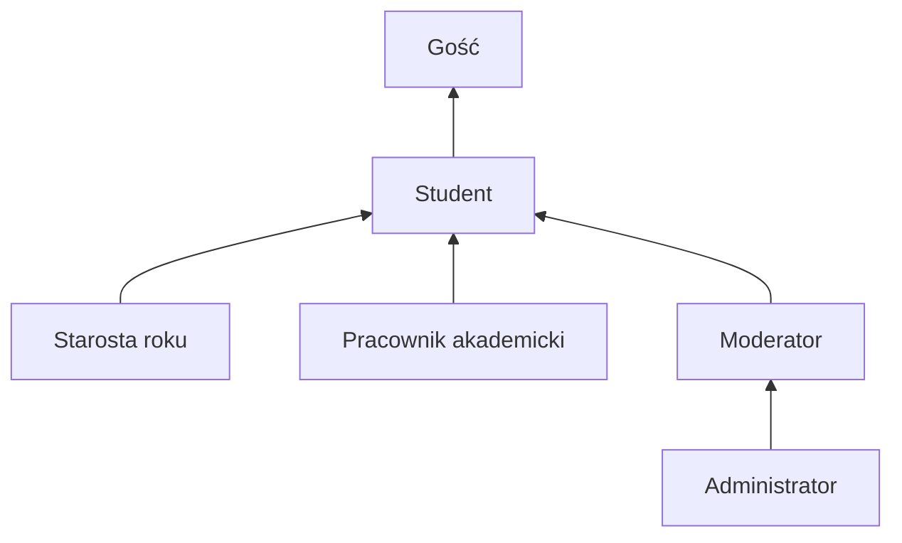
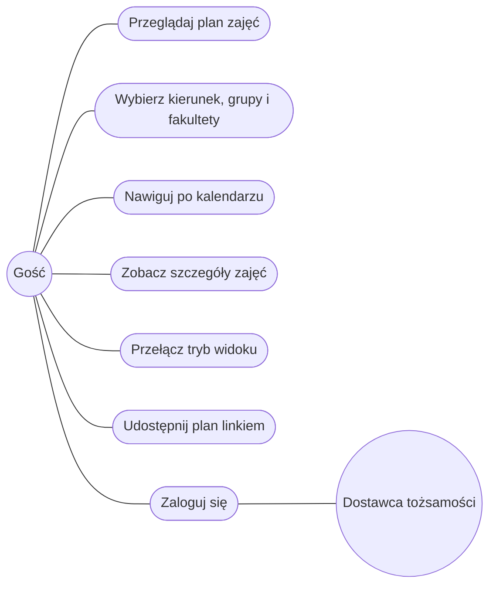
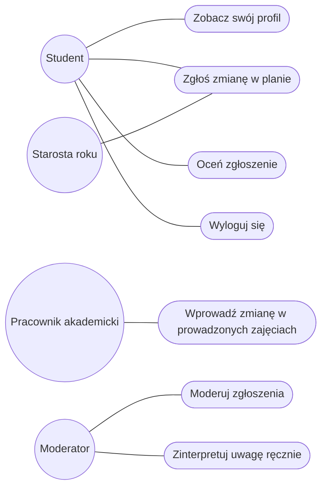
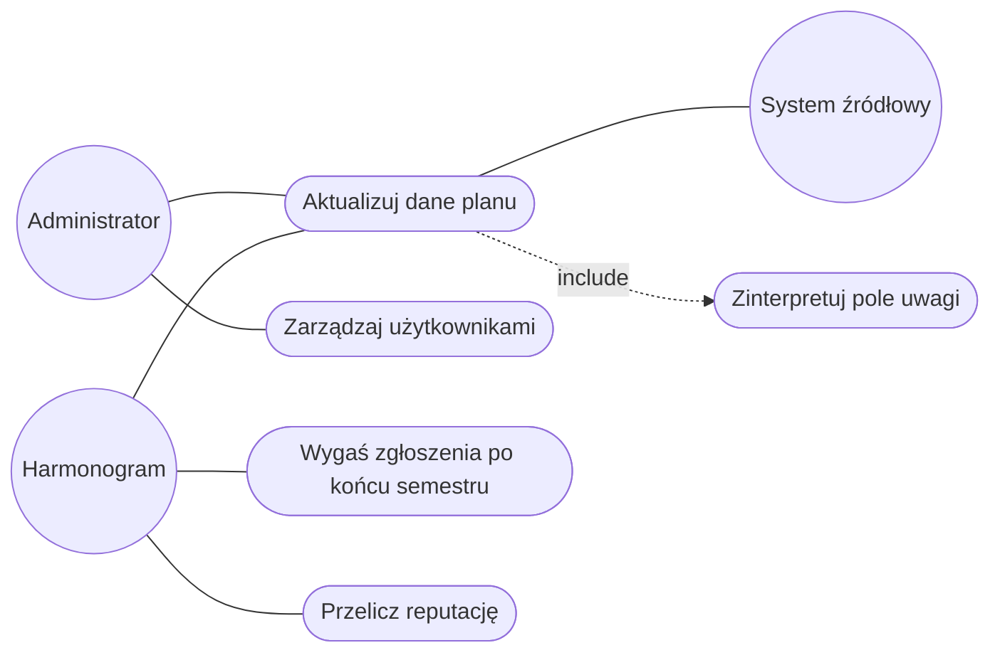

# SPECYFIKACJA WYMAGAŃ

## DLA PLANR

### WERSJA 0.1

Gdańsk, 18.11.2026

---

## SPIS TREŚCI

1. [Wprowadzenie](#1-wprowadzenie)
   1. [Cel dokumentu](#11-cel-dokumentu)
   2. [Przyjęte zasady w dokumencie](#12-przyjęte-zasady-w-dokumencie)
   3. [Zakres produktu](#13-zakres-produktu)
   4. [Literatura](#14-literatura)
2. [Opis ogólny](#2-opis-ogólny)
   1. [Perspektywa produktu](#21-perspektywa-produktu)
   2. [Funkcje produktu](#22-funkcje-produktu)
   3. [Ograniczenia](#23-ograniczenia)
   4. [Dokumentacja użytkownika](#24-dokumentacja-użytkownika)
   5. [Założenia i zależności](#25-założenia-i-zależności)
3. [Model procesów biznesowych](#3-model-procesów-biznesowych)
   1. [Aktorzy i charakterystyka użytkowników](#31-aktorzy-i-charakterystyka-użytkowników)
   2. [Obiekty biznesowe](#32-obiekty-biznesowe)
4. [Wymagania funkcjonalne](#4-wymagania-funkcjonalne)
   1. [Przypadki użycia](#41-przypadki-użycia)
5. [Charakterystyka interfejsów](#5-charakterystyka-interfejsów)
   1. [Interfejs użytkownika](#51-interfejs-użytkownika)
   2. [Interfejsy zewnętrzne](#52-interfejsy-zewnętrzne)
6. [Wymagania pozafunkcjonalne](#6-wymagania-pozafunkcjonalne)

---

## 1. WPROWADZENIE

### 1.1. CEL DOKUMENTU

Dokument stanowi jedyne źródło wymagań aplikacji Planr (nazwa robocza). Stanowi podstawę dla specyfikacji oprogramowania oraz dla planowania kolejnych etapów prac.

Dokument przeznaczony jest głównie dla zespołu deweloperskiego zajmującego się wytwarzaniem oprogramowania Planr, a pomocniczo dla prowadzącego przedmiot oraz osób oceniających projekt.

### 1.2. PRZYJĘTE ZASADY W DOKUMENCIE

Każde wymaganie i każdy przypadek użycia posiada priorytet:

| Priorytet | Znaczenie |
|---|---|
| **P0** | Funkcjonalność minimalna. Wymaganie konieczne do uznania produktu za działający. |
| **P1** | Funkcjonalność rozbudowana (system kont i system społecznościowy). Realizowana po spełnieniu wszystkich wymagań P0. |
| **P2** | Funkcjonalność opcjonalna. Realizowana zależnie od ilości dostępnego czasu. |

Pozostałe zasady:

- Słowo **musi** oznacza wymaganie obowiązkowe, słowo **powinien** – wymaganie zalecane.
- Nazwy elementów interfejsu użytkownika zapisano kursywą, np. *Wybierz kierunek*.
- Identyfikatory przypadków użycia i wymagań pozafunkcjonalnych zapisano wielkimi literami lub w notacji `CamelCase`, np. `ViewPlan`, `SECURITY`.
- Pojęcia „plan” i „rozkład zajęć” są używane zamiennie.
- Godzina akademicka trwa 45 minut.

### 1.3. ZAKRES PRODUKTU

Celem projektu jest stworzenie alternatywnego frontendu dla planu zajęć Wydziału Matematyki, Fizyki i Informatyki Uniwersytetu Gdańskiego (MFI UG), wzbogaconego o funkcje społecznościowe.

System będzie cyklicznie pobierał dane z uczelnianego systemu planistycznego (`inf.ug.edu.pl/plan`), przetwarzał je i prezentował w postaci czytelnego, tygodniowego kalendarza dla wybranego kierunku, grup oraz przedmiotów fakultatywnych (fakultetów).

Istotną częścią systemu jest interpretacja pola „uwagi”, w którym osoby układające plan zapisują swobodnym tekstem informacje zmieniające znaczenie podstawowych danych (np. inne godziny zajęć, zajęcia zdalne, zajęcia tylko w określonym przedziale dat). System będzie odzwierciedlał te informacje bezpośrednio na planie.

W wersji rozbudowanej system umożliwi zalogowanym członkom społeczności akademickiej zgłaszanie zmian w planie (np. odwołanych zajęć, zmiany sali), ocenianie zgłoszeń innych użytkowników oraz ich moderację. Wiarygodność zgłoszeń zapewni system ról i reputacji.

Przechowywanie historii wersji planu, wyników analizy uwag, kont użytkowników i zgłoszeń wymusza składowanie danych w bazie danych.

### 1.4. LITERATURA

1. Rozporządzenie Parlamentu Europejskiego i Rady (UE) 2016/679 z dnia 27 kwietnia 2016 r. w sprawie ochrony osób fizycznych w związku z przetwarzaniem danych osobowych i w sprawie swobodnego przepływu takich danych (RODO).
2. Ustawa z dnia 10 maja 2018 r. o ochronie danych osobowych (Dz. U. 2018 poz. 1000 z późn. zm.).
3. RFC 4180 – Common Format and MIME Type for Comma-Separated Values (CSV) Files.
4. RFC 9110 – HTTP Semantics.
5. OpenAPI Specification 3.1.
6. OpenID Connect Core 1.0 oraz dokumentacja Microsoft identity platform (Microsoft Entra ID).
7. Plan zajęć Wydziału MFI UG – `https://inf.ug.edu.pl/plan/`.
8. Dokumentacja projektu Planr (`dokumentacja_projektu_planr.md`).

---

## 2. OPIS OGÓLNY

### 2.1. PERSPEKTYWA PRODUKTU

System informatyczny Planr będzie serwisem internetowym ułatwiającym studentom i pracownikom Wydziału MFI UG korzystanie z planu zajęć. Nie zastępuje on uczelnianego systemu planistycznego – jest jego nakładką: uczelniany system pozostaje jedynym źródłem danych bazowych, a Planr prezentuje je w czytelniejszej formie i uzupełnia o informacje pochodzące z analizy uwag oraz od społeczności.

Planr będzie wystawiał interfejs dla użytkownika w postaci strony WWW (aplikacja jednostronicowa, SPA) działającej na komputerach i urządzeniach mobilnych. System będzie operował na bazie danych, w której będzie przechowywał:

- kolejne wersje (migawki) planu pobranego z systemu źródłowego,
- katalog kierunków, grup, przedmiotów, fakultetów i prowadzących,
- wyniki analizy pola „uwagi”,
- (P1) konta użytkowników, ich role i reputację,
- (P1) zgłoszenia zmian, oceny zgłoszeń i decyzje moderacji.

Architektura systemu składa się z następujących elementów:

| Element | Technologia | Rola |
|---|---|---|
| Moduł pobierania i analizy danych | Python | Pobiera strony i pliki CSV z systemu źródłowego, interpretuje uwagi, zapisuje migawkę planu. |
| Serwer aplikacji (API) | Python / FastAPI | Udostępnia dane planu przez REST API. |
| Baza danych | PostgreSQL | Przechowuje dane systemu; schemat zarządzany migracjami (Alembic). |
| Aplikacja kliencka | TypeScript / Angular, PrimeNG | Interfejs użytkownika. |
| Reverse proxy | Nginx | Serwuje aplikację kliencką i przekazuje żądania `/api/` do serwera aplikacji. |
| Konteneryzacja | Docker / Docker Compose | Uruchamianie wszystkich elementów systemu. |

### 2.2. FUNKCJE PRODUKTU

Zakres podstawowych funkcjonalności (P0) będzie obejmował:

- wybór kierunku i roku studiów, grup oraz fakultetów (i ich grup),
- prezentację planu w widoku tygodniowym z nawigacją między tygodniami oraz w widoku dziennym na urządzeniach mobilnych,
- prezentację szczegółów pojedynczych zajęć,
- interpretację pola „uwagi” i nanoszenie jej wyników na plan (np. zmienione godziny, tryb zdalny, zakres dat),
- przełączanie widoku między danymi oryginalnymi a danymi uzupełnionymi o uwagi,
- udostępnianie wybranego planu w postaci linku,
- automatyczną aktualizację danych z systemu źródłowego.

Zakres rozbudowanych funkcjonalności (P1) będzie obejmował:

- konta użytkowników zakładane przy pomocy e-maila uczelnianego / logowania przez Microsoft,
- system zgłaszania zmian w planie przez użytkowników,
- ocenę zgłoszeń przez innych użytkowników (plusowanie i minusowanie),
- moderację zgłoszeń oraz ręczną interpretację nierozpoznanych uwag,
- system ról i reputacji określający wagę zgłoszeń.

System będzie również wyposażony w funkcje pomocnicze (P2), takie jak: interpretacja uwag przy pomocy małego modelu językowego (LLM), automatyczne wykrywanie celowego wprowadzania błędnych zmian oraz wskaźnik bieżącej godziny na planie.

### 2.3. OGRANICZENIA

Grupą docelową systemu są studenci i pracownicy Wydziału MFI UG. Liczba użytkowników jest więc ograniczona do kilku tysięcy osób, a ruch skupia się w określonych momentach: na początku semestru, w poniedziałki rano oraz bezpośrednio po publikacji zmian w planie. Z tego powodu zakładamy, że system powinien być zaprojektowany, aby obsłużyć co najmniej **5 000** zarejestrowanych użytkowników, z czego **10% (500 osób)** korzysta z systemu jednocześnie.

Dane planu dla całego wydziału mają rozmiar rzędu pojedynczych megabajtów, a odpowiedzi API są wyznaczane z bazy danych bez odwołań do systemu źródłowego. Aby spełnić powyższe wymaganie, serwer powinien spełniać co najmniej następujące wymagania:

| Zasób | Wymaganie |
|---|---|
| Procesor | 2 vCPU (x86-64 lub ARM64) |
| Pamięć RAM | 4 GB |
| Przestrzeń dyskowa | 20 GB SSD (system, obrazy kontenerów, baza danych z historią migawek + bufor) |
| System operacyjny | Linux z obsługą Docker Engine i Docker Compose |
| Łącze | 100 Mb/s, publiczny adres IP lub domena z certyfikatem TLS |

Wymaganie może być spełnione przez własny serwer lub małą instancję chmurową (np. AWS EC2 klasy `t3.medium`). Zapewni to możliwość dalszego rozwoju.

Pozostałe ograniczenia:

1. System źródłowy nie udostępnia oficjalnego API. Dane są pobierane ze stron HTML i eksportów CSV, których format może ulec zmianie bez uprzedzenia.
2. Pole „uwagi” jest swobodnym tekstem – nie wszystkie uwagi da się zinterpretować automatycznie.
3. System nie może nadmiernie obciążać systemu źródłowego (zob. wymaganie `SOURCE_LOAD`).
4. Wszystkie dane źródłowe oraz interfejs są w języku polskim; czas jest liczony w strefie `Europe/Warsaw`.
5. Logowanie (P1) jest ograniczone do osób posiadających konto w domenie uczelnianej.

### 2.4. DOKUMENTACJA UŻYTKOWNIKA

| | |
|---|---|
| **Nazwa:** | Instrukcja użytkownika |
| **Opis zawartości:** | Opis interfejsu użytkownika, oznaczeń stosowanych na planie (zmienione godziny, tryb zdalny, uwagi, propozycje zmian) oraz sposobu korzystania z funkcjonalności systemu. |
| **Standard:** | Brak |
| **Format:** | HTML (strona pomocy w aplikacji) |
| **Język:** | Polski |

| | |
|---|---|
| **Nazwa:** | Specyfikacja interfejsu komunikacyjnego |
| **Opis zawartości:** | Specyfikacja REST API, dostępnych w nim zasobów oraz spis możliwych do wykonania na nich akcji. Opis formatów zapytań i odpowiedzi oraz kodów błędów. |
| **Standard:** | OpenAPI 3.1 (generowana automatycznie przez FastAPI) |
| **Format:** | JSON / HTML |
| **Język:** | Polski / angielski |

| | |
|---|---|
| **Nazwa:** | Dokumentacja wdrożeniowa |
| **Opis zawartości:** | Wymagania środowiska, konfiguracja (zmienne `PLANR_*`), uruchomienie natywne i w kontenerach Docker, migracje bazy danych, ręczna i cykliczna aktualizacja danych. |
| **Standard:** | Brak |
| **Format:** | Markdown (`README.md`) |
| **Język:** | Angielski |

| | |
|---|---|
| **Nazwa:** | Regulamin systemu i polityka prywatności (P1) |
| **Opis zawartości:** | Dokument prawny zawierający regulacje dotyczące korzystania z systemu, zasady zgłaszania zmian, zasady moderacji i blokowania kont oraz informacje o przetwarzaniu danych osobowych zgodnie z RODO. |
| **Standard:** | Brak |
| **Format:** | PDF / HTML |
| **Język:** | Polski |

### 2.5. ZAŁOŻENIA I ZALEŻNOŚCI

1. System źródłowy `inf.ug.edu.pl/plan` jest dostępny publicznie i udostępnia:
   - eksport głównego planu w formacie CSV (`?student=.*&seminarium=.&fakultet=.&format=csv`) – osobno dla podstrony informatyczno-matematycznej i podstrony fizyki (`/plan/fiz/`),
   - stronę z listą kierunków (`?dialog=grupa`, `/plan/fiz/`) zawierającą hiperłącza z identyfikatorami kierunków,
   - strony kierunków (`?grupa=<id>`) zawierające hiperłącza z identyfikatorami (FAID) przypisanych fakultetów,
   - eksport zajęć fakultetu w formacie CSV (`?zajecia=<faid>&format=csv`),
   - w stopce stron znacznik czasu „Aktualizacja danych”, pozwalający wykryć zmiany.
2. Plan obowiązuje w ramach semestru; wszystkie zgłoszenia zmian wygasają wraz z końcem semestru.
3. Jeden wiersz eksportu CSV opisuje jeden cykliczny termin zajęć (dzień tygodnia, godzina rozpoczęcia, liczba godzin akademickich, opcjonalny zakres dat, grupy, prowadzący, sala, uwagi).
4. (P1) Uczelnia udostępnia logowanie przez Microsoft Entra ID dla kont w domenie uczelnianej, a aplikacja zostanie w nim zarejestrowana.
5. (P2) Do interpretacji uwag dostępny jest mały model językowy uruchamiany lokalnie lub przez zewnętrzne API.
6. Użytkownicy korzystają z aktualnych wersji przeglądarek (zob. wymaganie `COMPATIBILITY`).

---

## 3. MODEL PROCESÓW BIZNESOWYCH

### 3.1. AKTORZY I CHARAKTERYSTYKA UŻYTKOWNIKÓW

| | |
|---|---|
| **ID:** | USER |
| **Nazwa:** | Użytkownik |
| **Opis:** | Użytkownik jest zbiorczym aktorem reprezentującym wszystkie osoby korzystające z systemu. |

| | |
|---|---|
| **ID:** | GUEST |
| **Nazwa:** | Gość |
| **Opis:** | Gość reprezentuje osobę niezalogowaną. Może przeglądać plan dowolnego kierunku, wybierać grupy i fakultety, przeglądać szczegóły zajęć (w tym propozycje zmian społeczności), udostępniać plan linkiem oraz zalogować się. Nie może zgłaszać ani oceniać zmian. |

| | |
|---|---|
| **ID:** | STUDENT |
| **Nazwa:** | Student |
| **Opis:** | Student to zalogowany członek społeczności akademickiej przypisany do kierunku, grupy i fakultetów. Może zgłaszać zmiany w planie i oceniać zgłoszenia innych użytkowników. Jego zgłoszenia i oceny mają największą wagę dla zajęć, w których uczestniczy. (P1) |

| | |
|---|---|
| **ID:** | STAROSTA |
| **Nazwa:** | Starosta roku |
| **Opis:** | Starosta to Student pełniący funkcję starosty roku. Jego zgłoszenia i oceny mają dużą wagę dla wszystkich zajęć danego roku kierunku. Rolę nadaje Administrator. (P1) |

| | |
|---|---|
| **ID:** | TEACHER |
| **Nazwa:** | Pracownik akademicki |
| **Opis:** | Pracownik akademicki to zalogowany prowadzący zajęcia. Ma pełną władzę nad zajęciami prowadzonymi przez siebie: jego zmiany w tych zajęciach są wprowadzane natychmiast, bez oceny społeczności. Powiązanie konta z prowadzącym z planu weryfikuje Administrator. (P1) |

| | |
|---|---|
| **ID:** | MODERATOR |
| **Nazwa:** | Moderator |
| **Opis:** | Moderator czuwa nad poprawnością zgłoszeń. Może zatwierdzać i odrzucać zgłoszenia ze skutkiem natychmiastowym oraz ręcznie interpretować uwagi, których system nie rozpoznał automatycznie. (P1) |

| | |
|---|---|
| **ID:** | ADMIN |
| **Nazwa:** | Administrator |
| **Opis:** | Administrator reprezentuje osobę zarządzającą oprogramowaniem. Odpowiada za wdrożenie, konfigurację i aktualizację danych z systemu źródłowego, nadaje role i blokuje konta. Ma pełną władzę nad danymi zamieszczonymi w bazie danych systemu. |

| | |
|---|---|
| **ID:** | SOURCE |
| **Nazwa:** | System źródłowy |
| **Opis:** | Aktor pomocniczy. Uczelniany system planistyczny `inf.ug.edu.pl/plan`, z którego pobierane są dane bazowe planu. |

| | |
|---|---|
| **ID:** | SCHEDULER |
| **Nazwa:** | Harmonogram |
| **Opis:** | Aktor pomocniczy. Mechanizm uruchamiający cyklicznie zadania systemowe (aktualizacja danych, wygaszanie zgłoszeń po końcu semestru, zmiany reputacji w czasie). |

| | |
|---|---|
| **ID:** | IDP |
| **Nazwa:** | Dostawca tożsamości |
| **Opis:** | Aktor pomocniczy. Microsoft Entra ID – usługa uwierzytelniająca konta uczelniane. (P1) |

### 3.2. OBIEKTY BIZNESOWE

| | |
|---|---|
| **Nazwa:** | Kierunek |
| **Opis:** | Kierunek studiów na danym roku, np. „informatyka (P): III rok”. Posiada identyfikator, nazwę, listę grup oraz listę przypisanych fakultetów. |

| | |
|---|---|
| **Nazwa:** | Grupa |
| **Opis:** | Grupa zajęciowa kierunku (np. „gr. 1”) lub grupa fakultetu. Zajęcia mogą dotyczyć jednej lub wielu grup albo całego kierunku. |

| | |
|---|---|
| **Nazwa:** | Przedmiot |
| **Opis:** | Przedmiot (kurs) prowadzony na wydziale, identyfikowany nazwą. |

| | |
|---|---|
| **Nazwa:** | Fakultet |
| **Opis:** | Przedmiot fakultatywny (do wyboru) przypisany do jednego lub wielu kierunków. Może posiadać własne grupy, prowadzących i terminy. |

| | |
|---|---|
| **Nazwa:** | Prowadzący |
| **Opis:** | Osoba prowadząca zajęcia, identyfikowana nazwą (wraz z tytułami) występującą w planie. |

| | |
|---|---|
| **Nazwa:** | Zajęcia (termin) |
| **Opis:** | Pojedynczy cykliczny termin zajęć pochodzący z jednego wiersza planu źródłowego. Zawiera przedmiot, typ zajęć (np. wykład, laboratorium), grupy, prowadzących, salę, dzień tygodnia, godzinę rozpoczęcia i liczbę godzin akademickich, opcjonalny zakres dat oraz uwagi. Dla każdych zajęć system wyznacza **dane obowiązujące** (dzień, godzina rozpoczęcia i zakończenia, tryb stacjonarny/zdalny, zakres dat) – dane bazowe zaktualizowane o wynik analizy uwag oraz o zatwierdzone zmiany – oraz listę pól, które zostały zmienione. |

| | |
|---|---|
| **Nazwa:** | Uwaga |
| **Opis:** | Treść pola „uwagi” zajęć wraz z wynikiem jej analizy: status (`ok` – w pełni zinterpretowana, `partial` – częściowo, `unparsed` – niezinterpretowana), niezinterpretowany fragment, flaga potrzeby weryfikacji, etap, który ją zinterpretował (`regex`, `llm`, `manual`), oraz rozpoznane wartości (np. godziny, tryb zdalny, zakres dat, wyłączone dni, zajęcia co dwa tygodnie, link do szczegółowego planu, budynek). |

| | |
|---|---|
| **Nazwa:** | Migawka planu |
| **Opis:** | Jedna pobrana i zapisana wersja planu ze wszystkich podstron systemu źródłowego. Zawiera skrót zawartości (wersję), czas pobrania i liczbę wierszy. Dokładnie jedna migawka jest bieżąca. Zajęcia nieobecne w bieżącej migawce są oznaczane jako nieaktywne. |

| | |
|---|---|
| **Nazwa:** | Konto użytkownika (P1) |
| **Opis:** | Konto osoby zalogowanej przez dostawcę tożsamości. Zawiera adres e-mail uczelniany, imię i nazwisko, rolę, reputację, przypisanie do kierunku, grup i fakultetów oraz status (aktywne/zablokowane). |

| | |
|---|---|
| **Nazwa:** | Rola (P1) |
| **Opis:** | Określa możliwości wprowadzania zmian i ich wagę: `student`, `starosta`, `pracownik`, `moderator`, `admin`. |

| | |
|---|---|
| **Nazwa:** | Reputacja (P1) |
| **Opis:** | Liczba określająca podstawową wagę zgłoszeń i ocen użytkownika. Dla nowych kont jest mała i z czasem rośnie do poziomu bazowego. Wzrasta wraz z liczbą zgłoszeń potwierdzonych przez społeczność lub moderację i z czasem spada z powrotem do poziomu bazowego. Spada (nie niżej niż do zera) wraz z liczbą zgłoszeń odrzuconych i z czasem powraca do poziomu bazowego. |

| | |
|---|---|
| **Nazwa:** | Zgłoszenie zmiany (P1) |
| **Opis:** | Propozycja zmiany w konkretnych zajęciach (lub w ich pojedynczym wystąpieniu) zgłoszona przez użytkownika, np. odwołanie, zmiana sali, godzin lub trybu. Zawiera autora, zajęcia, datę lub zakres dat, zmieniane pola i ich nowe wartości, opcjonalny komentarz, datę zgłoszenia, sumaryczną ocenę oraz status: `oczekujące`, `utrwalone` (przekroczony próg oceny), `zatwierdzone` / `odrzucone` (decyzja moderacji), `wygasłe`. |

| | |
|---|---|
| **Nazwa:** | Ocena zgłoszenia (P1) |
| **Opis:** | Głos „+” lub „−” oddany przez użytkownika na zgłoszenie. Waga głosu zależy od roli i reputacji głosującego oraz od tego, czy uczestniczy on w zajęciach, których zgłoszenie dotyczy. |

| | |
|---|---|
| **Nazwa:** | Semestr |
| **Opis:** | Okres obowiązywania planu. Z jego końcem wszystkie zgłoszenia zmian wygasają. |

---

## 4. WYMAGANIA FUNKCJONALNE

Wymagania funkcjonalne zostały przedstawione na diagramach przypadków użycia. W celu zwiększenia czytelności diagram został podzielony na trzy rysunki odpowiadające grupom aktorów, dlatego niektóre z przypadków użycia mogą się powtarzać.

Należy jednak zawsze rozpatrywać je jako kolejne rozszerzenia funkcjonalności. To znaczy, że Student posiada wszystkie funkcjonalności aktora Gość, Starosta roku i Pracownik akademicki posiadają wszystkie funkcjonalności Studenta, Moderator posiada wszystkie funkcjonalności Studenta, a Administrator posiada wszystkie funkcjonalności Moderatora. Wg następującego schematu:

### 4.1. PRZYPADKI UŻYCIA

**Rysunek 1. Przypadki użycia aktora Gość (P0)**

**Rysunek 2. Przypadki użycia aktorów zalogowanych (P1)**

**Rysunek 3. Przypadki użycia Administratora i aktorów systemowych**

---

| | | | |
|---|---|---|---|
| **ID:** | `ViewPlan` | | |
| **Nazwa:** | Przeglądaj plan zajęć | | |
| **Aktorzy główni:** | Wszyscy | | |
| **Aktorzy pomocniczy:** | Brak | | |
| **Poziom:** | Użytkownika | **Priorytet:** | P0 |

**Opis:**
Użytkownik otwiera interfejs systemu i widzi tygodniowy plan zajęć dla ostatnio wybranego kierunku, grup i fakultetów.

**Wyzwalacze:**
1. Użytkownik uruchamia interfejs systemu.

**Warunki początkowe:**
1. W systemie znajduje się co najmniej jedna migawka planu.

**Warunki końcowe:**
1. Użytkownik widzi plan zajęć na bieżący tydzień.

**Scenariusz główny:**
1. Użytkownik uruchamia interfejs systemu.
2. System odtwarza ostatni wybór użytkownika (kierunek, grupy, fakultety, tryb widoku) zapamiętany w przeglądarce.
3. System pobiera plan na bieżący tydzień (od poniedziałku do niedzieli).
4. System wyświetla plan w postaci siatki: kolumny to dni tygodnia, oś pionowa to godziny. Każde zajęcia są przedstawione jako karta zawierająca:
   1. godziny zajęć,
   2. nazwę przedmiotu,
   3. typ zajęć i grupę,
   4. salę i prowadzących,
   5. oznaczenia: zmienione godziny, zajęcia zdalne, ograniczony zakres dat, istnienie uwagi.
5. System wyróżnia bieżący dzień i wyświetla datę ostatniego pobrania danych z systemu źródłowego.

**Scenariusze alternatywne:**
1. Użytkownik nie wybrał wcześniej kierunku:
   1. System wyświetla komunikat „Wybierz kierunek, aby zobaczyć plan.” oraz formularz wyboru (zob. `SelectPlan`).
2. Adres strony zawiera parametry planu (link udostępniony, zob. `SharePlan`):
   1. System wyświetla plan opisany parametrami zamiast zapamiętanego.

**Rozszerzenia:**
1. Na urządzeniu o wąskim ekranie system wyświetla widok jednego dnia z możliwością przechodzenia między dniami przyciskami lub gestem przesunięcia.
2. (P1) Dla zajęć posiadających oczekujące zgłoszenia zmian system wyświetla je w sposób odróżniający je od zmian potwierdzonych.

**Wyjątki:**
1. Brak danych w systemie (nie wykonano jeszcze pierwszej aktualizacji):
   1. System wyświetla komunikat o niedostępności danych.
2. Serwer aplikacji jest niedostępny:
   1. System wyświetla komunikat o błędzie połączenia.

**Dodatkowe wymagania:**
1. Godzina zakończenia zajęć jest wyznaczana jako godzina rozpoczęcia + liczba godzin akademickich × 45 min, chyba że uwagi lub zatwierdzone zmiany stanowią inaczej.
2. Zajęcia nachodzące na siebie w czasie muszą być wyświetlane obok siebie i nie mogą się wzajemnie zasłaniać.
3. Plan musi uwzględniać zakres dat zajęć – w danym tygodniu wyświetlane są tylko zajęcia, które się w nim odbywają.

---

| | | | |
|---|---|---|---|
| **ID:** | `SelectPlan` | | |
| **Nazwa:** | Wybierz kierunek, grupy i fakultety | | |
| **Aktorzy główni:** | Wszyscy | | |
| **Aktorzy pomocniczy:** | Brak | | |
| **Poziom:** | Użytkownika | **Priorytet:** | P0 |

**Opis:**
Użytkownik określa, jaki plan chce zobaczyć: wybiera kierunek i rok studiów, swoje grupy oraz fakultety wraz z grupami fakultetów.

**Wyzwalacze:**
1. Użytkownik rozwija jedną z list wyboru na pasku narzędzi.

**Warunki początkowe:**
1. Katalog kierunków jest dostępny.

**Warunki końcowe:**
1. System wyświetla plan zawierający zajęcia całego kierunku, wybranych grup oraz wybranych fakultetów.

**Scenariusz główny:**
1. Użytkownik wybiera opcję *Wybierz kierunek*.
2. System wyświetla listę kierunków z polem wyszukiwania.
3. Użytkownik wybiera kierunek.
4. System wyświetla plan kierunku i udostępnia listę *Grupy*.
5. Użytkownik zaznacza jedną lub więcej grup.
6. System aktualizuje plan bez przeładowania strony.

**Scenariusze alternatywne:**
1. Użytkownik zmienia kierunek:
   1. System usuwa wybór grup i fakultetów, ponieważ należą one do poprzedniego kierunku.

**Rozszerzenia:**
1. Użytkownik może wybrać fakultety:
   1. Jeśli do kierunku przypisane są fakultety, system wyświetla listę *Fakultatywne* z polem wyszukiwania, pogrupowaną według przedmiotów.
   2. Użytkownik zaznacza fakultet i jego grupę (lub fakultet bez podziału na grupy).
   3. System dodaje zajęcia wybranych fakultetów do planu.
2. (P1) Zalogowany użytkownik z przypisanym kierunkiem i grupami widzi je jako wybór domyślny.

**Wyjątki:**
1. Wybrany kierunek nie istnieje (np. nieaktualny link):
   1. System wyświetla komunikat o nieznanym kierunku.

**Dodatkowe wymagania:**
1. Niewybranie żadnej grupy oznacza wyświetlenie wyłącznie zajęć ogólnych dla całego kierunku.
2. Wybór musi być zapamiętany w przeglądarce i odtworzony przy kolejnej wizycie.

---

| | | | |
|---|---|---|---|
| **ID:** | `NavigateCalendar` | | |
| **Nazwa:** | Nawiguj po kalendarzu | | |
| **Aktorzy główni:** | Wszyscy | | |
| **Aktorzy pomocniczy:** | Brak | | |
| **Poziom:** | Użytkownika | **Priorytet:** | P0 |

**Opis:**
Użytkownik przegląda plan na inne tygodnie (oraz inne dni w widoku mobilnym).

**Wyzwalacze:**
1. Użytkownik wybiera opcję *Poprzedni tydzień* lub *Następny tydzień*.

**Warunki początkowe:**
1. Wyświetlany jest plan wybranego kierunku.

**Warunki końcowe:**
1. Użytkownik widzi plan na wybrany tydzień.

**Scenariusz główny:**
1. Użytkownik wybiera opcję *Następny tydzień* (lub *Poprzedni tydzień*).
2. System pobiera plan na wskazany tydzień.
3. System wyświetla plan oraz zakres dat tygodnia.

**Scenariusze alternatywne:**
Brak.

**Rozszerzenia:**
1. Gdy wyświetlany tydzień nie jest bieżącym, system udostępnia opcję *Dziś*:
   1. Użytkownik wybiera opcję *Dziś*.
   2. System wyświetla bieżący tydzień i wyróżnia bieżący dzień.
2. W widoku jednego dnia użytkownik przechodzi do poprzedniego/następnego dnia przyciskami lub gestem przesunięcia; przejście poza pierwszy lub ostatni wyświetlany dzień tygodnia przenosi do sąsiedniego tygodnia.

**Wyjątki:**
Brak.

**Dodatkowe wymagania:**
1. Podczas pobierania nowego tygodnia poprzedni plan pozostaje widoczny (z oznaczeniem ładowania), aby interfejs nie „migał”.
2. Zmiana tygodnia nie może tworzyć nowych wpisów w historii przeglądarki.

---

| | | | |
|---|---|---|---|
| **ID:** | `ClassDetails` | | |
| **Nazwa:** | Zobacz szczegóły zajęć | | |
| **Aktorzy główni:** | Wszyscy | | |
| **Aktorzy pomocniczy:** | Brak | | |
| **Poziom:** | Użytkownika | **Priorytet:** | P0 |

**Opis:**
Użytkownik wyświetla pełne informacje o wybranych zajęciach.

**Wyzwalacze:**
1. Użytkownik wybiera kartę zajęć na planie.

**Warunki początkowe:**
1. Wyświetlany jest plan zawierający zajęcia.

**Warunki końcowe:**
1. Użytkownik widzi szczegóły zajęć.

**Scenariusz główny:**
1. Użytkownik wybiera kartę zajęć.
2. System wyświetla okno szczegółów zawierające: godziny, nazwę przedmiotu, typ, grupę, tryb (zdalnie/stacjonarnie), salę, prowadzących, zakres dat, pełną treść uwagi oraz informację o zmianach wynikających z uwag.
3. Użytkownik zamyka okno.

**Scenariusze alternatywne:**
Brak.

**Rozszerzenia:**
1. (P1) System wyświetla listę zgłoszeń zmian dla zajęć wraz z ich oceną i statusem.
   1. Zalogowany użytkownik może przejść do `ProposeChange` lub `VoteProposal`.

**Wyjątki:**
Brak.

**Dodatkowe wymagania:**
1. Uwagi, których system nie zinterpretował w pełni, muszą być wyróżnione.
2. Treść uwagi musi być zawsze dostępna w oryginalnym brzmieniu.

---

| | | | |
|---|---|---|---|
| **ID:** | `SwitchView` | | |
| **Nazwa:** | Przełącz tryb widoku | | |
| **Aktorzy główni:** | Wszyscy | | |
| **Aktorzy pomocniczy:** | Brak | | |
| **Poziom:** | Użytkownika | **Priorytet:** | P0 |

**Opis:**
Użytkownik przełącza się między widokiem *Oryginalny* (zwięzłe karty z ikonami informującymi o uwagach) a widokiem *Z uwagami* (karty uzupełnione o treść uwag i informację o zgłoszeniach użytkowników).

**Wyzwalacze:**
1. Użytkownik wybiera jeden z trybów na przełączniku widoku.

**Warunki początkowe:**
1. Wyświetlany jest plan.

**Warunki końcowe:**
1. Plan jest wyświetlany w wybranym trybie.

**Scenariusz główny:**
1. Użytkownik wybiera tryb *Z uwagami*.
2. System wyświetla na kartach zajęć treść uwag oraz liczbę zgłoszeń użytkowników.

**Scenariusze alternatywne:**
1. Użytkownik wybiera tryb *Oryginalny*:
   1. System wyświetla karty bez treści uwag, z ikonami i podpowiedziami.

**Rozszerzenia:**
Brak.

**Wyjątki:**
Brak.

**Dodatkowe wymagania:**
1. Tryb widoku jest preferencją użytkownika – zapamiętywany w przeglądarce, ale niebędący częścią udostępnianego linku.

---

| | | | |
|---|---|---|---|
| **ID:** | `SharePlan` | | |
| **Nazwa:** | Udostępnij plan linkiem | | |
| **Aktorzy główni:** | Wszyscy | | |
| **Aktorzy pomocniczy:** | Brak | | |
| **Poziom:** | Użytkownika | **Priorytet:** | P0 |

**Opis:**
Użytkownik kopiuje adres strony, aby udostępnić lub zapisać w zakładkach dokładnie ten plan, który widzi.

**Wyzwalacze:**
1. Użytkownik kopiuje adres strony z paska adresu przeglądarki.

**Warunki początkowe:**
1. Wyświetlany jest plan.

**Warunki końcowe:**
1. Otwarcie skopiowanego adresu wyświetla ten sam kierunek, grupy, fakultety i tydzień.

**Scenariusz główny:**
1. System na bieżąco zapisuje w adresie strony parametry planu: `program`, `group` (powtarzalny), `elective` (powtarzalny), `from`, `to`.
2. Użytkownik kopiuje adres.
3. Inna osoba otwiera adres.
4. System wyświetla plan opisany parametrami.

**Scenariusze alternatywne:**
Brak.

**Rozszerzenia:**
Brak.

**Wyjątki:**
1. Adres zawiera nieprawidłowe daty:
   1. System wyświetla bieżący tydzień.

**Dodatkowe wymagania:**
Brak.

---

| | | | |
|---|---|---|---|
| **ID:** | `Login` | | |
| **Nazwa:** | Zaloguj się | | |
| **Aktorzy główni:** | Gość | | |
| **Aktorzy pomocniczy:** | Dostawca tożsamości | | |
| **Poziom:** | Użytkownika | **Priorytet:** | P1 |

**Opis:**
Gość posiada konto uczelniane i chce zalogować się do systemu, aby korzystać z funkcji społecznościowych.

**Wyzwalacze:**
1. Gość wybiera opcję *Zaloguj się*.

**Warunki początkowe:**
1. Gość jest niezalogowany.

**Warunki końcowe:**
1. Gość jest zalogowany jako Student, Starosta roku, Pracownik akademicki, Moderator lub Administrator i ma dostęp do funkcji niedostępnych dla użytkownika niezalogowanego.

**Scenariusz główny:**
1. Gość wybiera opcję *Zaloguj się*.
2. System przekierowuje Gościa do strony logowania Microsoft.
3. Gość podaje dane konta uczelnianego u Dostawcy tożsamości.
4. Dostawca tożsamości przekierowuje Gościa z powrotem do systemu.
5. System weryfikuje odpowiedź Dostawcy tożsamości oraz domenę adresu e-mail.
6. System loguje użytkownika i wyświetla plan wraz z opcjami dostępnymi po zalogowaniu.

**Scenariusze alternatywne:**
Brak.

**Rozszerzenia:**
1. Pierwsze logowanie:
   1. System tworzy konto z rolą Student i początkową (niską) reputacją.
   2. System prosi o wskazanie kierunku, grup i fakultetów (domyślnie wypełnione bieżącym wyborem).
   3. Użytkownik zatwierdza.

**Wyjątki:**
1. Adres e-mail nie należy do domeny uczelnianej:
   1. System wyświetla informację, że logowanie jest dostępne wyłącznie dla kont uczelnianych.
2. Konto jest zablokowane:
   1. System wyświetla informację o blokadzie konta.
3. Gość anuluje logowanie lub logowanie się nie powiedzie:
   1. System wyświetla plan jak dla Gościa.

**Dodatkowe wymagania:**
1. System nie przechowuje haseł użytkowników – uwierzytelnianie odbywa się wyłącznie u Dostawcy tożsamości.

---

| | | | |
|---|---|---|---|
| **ID:** | `Profile` | | |
| **Nazwa:** | Zobacz swój profil | | |
| **Aktorzy główni:** | Student, Starosta roku, Pracownik akademicki, Moderator, Administrator | | |
| **Aktorzy pomocniczy:** | Brak | | |
| **Poziom:** | Użytkownika | **Priorytet:** | P1 |

**Opis:**
Użytkownik może obejrzeć swój profil (rola, reputacja, kierunek, grupy, fakultety, historia zgłoszeń) oraz zmienić przypisanie do kierunku, grup i fakultetów.

**Wyzwalacze:**
1. Użytkownik wybiera opcję *Mój profil*.

**Warunki początkowe:**
1. Użytkownik musi być zalogowany.

**Warunki końcowe:**
1. Użytkownik widzi swoje dane.

**Scenariusz główny:**
1. Użytkownik wybiera opcję *Mój profil*.
2. System wyświetla dane konta, rolę, reputację, przypisanie do kierunku/grup/fakultetów oraz listę zgłoszeń użytkownika z ich statusami.
3. System wyświetla opcję *Edytuj*.

**Scenariusze alternatywne:**
Brak.

**Rozszerzenia:**
1. Użytkownik wybiera opcję *Edytuj*:
   1. System wyświetla formularz przypisania do kierunku, grup i fakultetów.
   2. Użytkownik dokonuje zmian oraz zatwierdza lub odrzuca zmiany.
      1. Gdy użytkownik zatwierdza zmiany, system aktualizuje dane.
      2. Gdy użytkownik odrzuca zmiany, system pokazuje profil sprzed zmian.
2. Użytkownik wybiera opcję *Usuń konto*:
   1. System prosi o potwierdzenie.
   2. System usuwa dane osobowe użytkownika; zgłoszenia pozostają w systemie jako anonimowe.

**Wyjątki:**
Brak.

**Dodatkowe wymagania:**
1. Imię, nazwisko i e-mail pochodzą od Dostawcy tożsamości i nie są edytowalne.
2. Rola może zostać zmieniona wyłącznie przez Administratora.

---

| | | | |
|---|---|---|---|
| **ID:** | `ProposeChange` | | |
| **Nazwa:** | Zgłoś zmianę w planie | | |
| **Aktorzy główni:** | Student, Starosta roku | | |
| **Aktorzy pomocniczy:** | Brak | | |
| **Poziom:** | Użytkownika | **Priorytet:** | P1 |

**Opis:**
Użytkownik zgłasza zmianę dotyczącą zajęć, np. odwołanie zajęć w danym dniu, zmianę sali, godzin lub trybu prowadzenia.

**Wyzwalacze:**
1. Użytkownik wybiera opcję *Zgłoś zmianę* w szczegółach zajęć.

**Warunki początkowe:**
1. Użytkownik musi być zalogowany, a jego konto nie może być zablokowane.

**Warunki końcowe:**
1. Zgłoszenie zostało zapisane w systemie ze statusem `oczekujące`.
2. Zgłoszenie jest widoczne na planie dla wszystkich użytkowników w sposób odróżniający je od zmian potwierdzonych.

**Scenariusz główny:**
1. Użytkownik wybiera opcję *Zgłoś zmianę* w szczegółach zajęć.
2. System wyświetla formularz zawierający:
   1. rodzaj zmiany: *Odwołanie*, *Zmiana sali*, *Zmiana godzin*, *Zmiana trybu*, *Inne*,
   2. datę pojedynczego wystąpienia lub zakres dat,
   3. nową wartość zmienianego pola,
   4. komentarz (opcjonalnie).
3. Użytkownik wypełnia formularz i zatwierdza.
4. System zapisuje zgłoszenie, nadając mu wagę początkową zależną od roli i reputacji autora oraz od tego, czy autor uczestniczy w zajęciach.
5. System wyświetla potwierdzenie i aktualizuje plan.

**Scenariusze alternatywne:**
1. Użytkownik jest Starostą roku:
   1. Zgłoszenie dotyczące dowolnych zajęć danego roku kierunku otrzymuje dużą wagę początkową.

**Rozszerzenia:**
1. Jeśli sumaryczna ocena zgłoszenia przekroczy próg utrwalenia (zob. `VoteProposal`), zgłoszenie zostaje utrwalone w planie.

**Wyjątki:**
1. Data zgłoszenia nie należy do zakresu dat zajęć:
   1. System wyświetla informację o błędnej dacie i ponownie wyświetla formularz.
2. Istnieje już oczekujące zgłoszenie o tej samej treści:
   1. System informuje o duplikacie i proponuje ocenę istniejącego zgłoszenia.
3. Użytkownik przekroczył limit zgłoszeń w danym okresie:
   1. System informuje o limicie i nie zapisuje zgłoszenia.

**Dodatkowe wymagania:**
1. Zgłoszenie musi zawierać informację o autorze, dacie zgłoszenia oraz zajęciach, których dotyczy.
2. Zgłoszenie wygasa wraz z końcem semestru.
3. Zgłoszenie nie może zmieniać danych zatwierdzonych przez moderację lub Pracownika akademickiego; w razie kolizji system informuje o niej użytkownika.

---

| | | | |
|---|---|---|---|
| **ID:** | `VoteProposal` | | |
| **Nazwa:** | Oceń zgłoszenie | | |
| **Aktorzy główni:** | Student, Starosta roku, Pracownik akademicki, Moderator, Administrator | | |
| **Aktorzy pomocniczy:** | Brak | | |
| **Poziom:** | Użytkownika | **Priorytet:** | P1 |

**Opis:**
Użytkownik potwierdza („+”) lub zaprzecza („−”) zgłoszeniu zmiany innego użytkownika.

**Wyzwalacze:**
1. Użytkownik wybiera opcję *+* lub *−* przy zgłoszeniu.

**Warunki początkowe:**
1. Użytkownik musi być zalogowany.
2. Zgłoszenie ma status `oczekujące` lub `utrwalone`.

**Warunki końcowe:**
1. Ocena została zapisana, a sumaryczna ocena zgłoszenia przeliczona.

**Scenariusz główny:**
1. Użytkownik wybiera opcję *+* przy zgłoszeniu.
2. System zapisuje głos z wagą zależną od roli i reputacji głosującego oraz jego uczestnictwa w zajęciach.
3. System przelicza sumaryczną ocenę zgłoszenia.
4. System wyświetla zaktualizowaną ocenę.

**Scenariusze alternatywne:**
1. Użytkownik wybiera *−*: przebieg analogiczny, głos obniża ocenę zgłoszenia.
2. Użytkownik ponownie wybiera oddany wcześniej głos: system wycofuje głos.

**Rozszerzenia:**
1. Ocena przekracza próg utrwalenia:
   1. System zmienia status zgłoszenia na `utrwalone` i nakłada zmianę na dane obowiązujące zajęć.
   2. System zwiększa reputację autora zgłoszenia.
2. Ocena spada poniżej progu odrzucenia:
   1. System zmienia status zgłoszenia na `odrzucone` i usuwa je z planu.
   2. System obniża reputację autora zgłoszenia.

**Wyjątki:**
1. Użytkownik próbuje ocenić własne zgłoszenie:
   1. System nie pozwala na oddanie głosu.

**Dodatkowe wymagania:**
1. Jeden użytkownik może oddać na zgłoszenie co najwyżej jeden głos.
2. Progi utrwalenia i odrzucenia muszą być konfigurowalne.

---

| | | | |
|---|---|---|---|
| **ID:** | `TeacherChange` | | |
| **Nazwa:** | Wprowadź zmianę w prowadzonych zajęciach | | |
| **Aktorzy główni:** | Pracownik akademicki | | |
| **Aktorzy pomocniczy:** | Brak | | |
| **Poziom:** | Użytkownika | **Priorytet:** | P1 |

**Opis:**
Pracownik akademicki wprowadza zmianę w zajęciach, które prowadzi (np. odwołanie, zmiana sali). Zmiana ma skutek natychmiastowy.

**Wyzwalacze:**
1. Pracownik wybiera opcję *Wprowadź zmianę* w szczegółach prowadzonych zajęć.

**Warunki początkowe:**
1. Pracownik jest zalogowany, a jego konto jest powiązane z prowadzącym tych zajęć.

**Warunki końcowe:**
1. Zmiana ma status `zatwierdzone` i jest nałożona na dane obowiązujące zajęć.

**Scenariusz główny:**
1. Pracownik wybiera opcję *Wprowadź zmianę*.
2. System wyświetla formularz jak w `ProposeChange`.
3. Pracownik wypełnia formularz i zatwierdza.
4. System zapisuje zmianę ze statusem `zatwierdzone` i aktualizuje plan.

**Scenariusze alternatywne:**
1. Pracownik wybiera zajęcia, których nie prowadzi:
   1. System traktuje zmianę jak zgłoszenie Studenta (`ProposeChange`).

**Rozszerzenia:**
1. Pracownik może odrzucić oczekujące zgłoszenie dotyczące prowadzonych zajęć – efekt jak w `ModerateProposals`.

**Wyjątki:**
Brak.

**Dodatkowe wymagania:**
1. Zmiana jest oznaczona na planie jako wprowadzona przez prowadzącego.

---

| | | | |
|---|---|---|---|
| **ID:** | `ModerateProposals` | | |
| **Nazwa:** | Moderuj zgłoszenia | | |
| **Aktorzy główni:** | Moderator, Administrator | | |
| **Aktorzy pomocniczy:** | Brak | | |
| **Poziom:** | Użytkownika | **Priorytet:** | P1 |

**Opis:**
Moderator przegląda zgłoszenia zmian i rozstrzyga je ze skutkiem natychmiastowym.

**Wyzwalacze:**
1. Moderator wybiera opcję *Moderacja*.

**Warunki początkowe:**
1. Użytkownik musi być zalogowany jako Moderator lub Administrator.

**Warunki końcowe:**
1. Wybrane zgłoszenia zostały zatwierdzone lub odrzucone.

**Scenariusz główny:**
1. Moderator wybiera opcję *Moderacja*.
2. System wyświetla listę zgłoszeń z możliwością filtrowania po statusie, kierunku i dacie oraz sortowania po ocenie i dacie zgłoszenia.
3. Moderator wybiera zgłoszenie.
4. System wyświetla szczegóły zgłoszenia, oceny i dane zajęć.
5. Moderator wybiera opcję *Zatwierdź* i zatwierdza.
6. System zmienia status zgłoszenia na `zatwierdzone`, nakłada zmianę na plan i zwiększa reputację autora.

**Scenariusze alternatywne:**
1. Moderator wybiera opcję *Odrzuć*:
   1. System zmienia status zgłoszenia na `odrzucone`, usuwa je z planu i obniża reputację autora.

**Rozszerzenia:**
1. Moderator może zablokować autora zgłoszenia (przejście do `ManageUsers`).
2. (P2) System wyróżnia zgłoszenia oznaczone przez mechanizm wykrywania nadużyć.

**Wyjątki:**
Brak.

**Dodatkowe wymagania:**
1. Każda decyzja moderacji jest zapisywana wraz z autorem i datą.
2. Decyzja moderacji ma pierwszeństwo przed oceną społeczności.

---

| | | | |
|---|---|---|---|
| **ID:** | `ReviewRemark` | | |
| **Nazwa:** | Zinterpretuj uwagę ręcznie | | |
| **Aktorzy główni:** | Moderator, Administrator | | |
| **Aktorzy pomocniczy:** | Brak | | |
| **Poziom:** | Użytkownika | **Priorytet:** | P1 |

**Opis:**
Moderator przegląda uwagi, których system nie zinterpretował w pełni automatycznie, i ręcznie określa ich znaczenie.

**Wyzwalacze:**
1. Moderator wybiera opcję *Uwagi do weryfikacji*.

**Warunki początkowe:**
1. Użytkownik musi być zalogowany jako Moderator lub Administrator.

**Warunki końcowe:**
1. Uwaga otrzymała status `ok` i etap `manual`, a jej wynik jest uwzględniony w danych obowiązujących zajęć.

**Scenariusz główny:**
1. Moderator wybiera opcję *Uwagi do weryfikacji*.
2. System wyświetla listę uwag oznaczonych jako wymagające weryfikacji, wraz z treścią, fragmentem niezinterpretowanym i zajęciami, których dotyczą.
3. Moderator wybiera uwagę.
4. System wyświetla formularz z polami: godzina rozpoczęcia, godzina zakończenia, tryb, zakres dat, wyłączone daty, częstotliwość.
5. Moderator wypełnia pola i zatwierdza.
6. System zapisuje interpretację i aktualizuje plan.

**Scenariusze alternatywne:**
1. Moderator oznacza uwagę jako niewpływającą na plan (informacyjną):
   1. System usuwa flagę weryfikacji bez zmiany danych obowiązujących.

**Rozszerzenia:**
Brak.

**Wyjątki:**
Brak.

**Dodatkowe wymagania:**
1. Ręczna interpretacja musi zostać zachowana przy kolejnych aktualizacjach danych, dopóki treść uwagi się nie zmieni.

---

| | | | |
|---|---|---|---|
| **ID:** | `RefreshData` | | |
| **Nazwa:** | Aktualizuj dane planu | | |
| **Aktorzy główni:** | Administrator, Harmonogram | | |
| **Aktorzy pomocniczy:** | System źródłowy | | |
| **Poziom:** | Systemowy | **Priorytet:** | P0 |

**Opis:**
System pobiera aktualne dane z systemu źródłowego, interpretuje je i zapisuje jako nową migawkę planu.

**Wyzwalacze:**
1. Harmonogram uruchamia aktualizację cyklicznie.
2. Administrator uruchamia aktualizację ręcznie (polecenie `python -m app.cli fetch`).

**Warunki początkowe:**
1. Baza danych jest dostępna i ma aktualny schemat.

**Warunki końcowe:**
1. Bieżąca migawka planu odpowiada aktualnemu stanowi systemu źródłowego.
2. Raport z aktualizacji (liczba wierszy, zajęć aktywnych i dezaktywowanych, uwag do weryfikacji) jest dostępny dla Administratora.

**Scenariusz główny:**
1. System pobiera strony list kierunków wszystkich podstron systemu źródłowego i odczytuje znaczniki „Aktualizacja danych”.
2. System porównuje znaczniki z zapisanymi przy poprzedniej aktualizacji.
3. System pobiera strony kierunków i odczytuje identyfikatory kierunków oraz przypisanych fakultetów (FAID).
4. System pobiera eksporty CSV głównego planu ze wszystkich podstron.
5. System dla każdego wiersza rozpoznaje kierunek, grupy, prowadzących i scala zduplikowane wiersze.
6. System interpretuje pole „uwagi” (zob. `ParseRemarks`).
7. System zapisuje nową migawkę: dodaje i aktualizuje zajęcia, a zajęcia nieobecne w nowej migawce oznacza jako nieaktywne.
8. System pobiera eksporty CSV fakultetów i zapisuje przypisanie fakultetów do kierunków.
9. System zapisuje nowe znaczniki „Aktualizacja danych”.

**Scenariusze alternatywne:**
1. Znaczniki wszystkich podstron są takie same jak zapisane:
   1. System kończy aktualizację z wynikiem „bez zmian”, nie pobierając pozostałych danych.
2. Administrator wymusza aktualizację (opcja `--force`):
   1. System pomija krok 2.

**Rozszerzenia:**
1. Administrator może zaimportować lokalny plik CSV (`ingest-file`) na potrzeby pracy offline.
2. (P1) Po zapisaniu migawki system ponownie nakłada zatwierdzone i utrwalone zmiany, o ile nie kolidują z nowymi danymi źródłowymi.

**Wyjątki:**
1. System źródłowy jest niedostępny lub zwraca błąd w trakcie pobierania list kierunków:
   1. System przerywa całą aktualizację bez zmiany danych i bez zapisu znaczników.
   2. Bieżąca migawka pozostaje bez zmian.
2. Zawartość planu jest identyczna z bieżącą migawką (ten sam skrót):
   1. System nie tworzy nowej migawki.

**Dodatkowe wymagania:**
1. Migawka zawsze powstaje z danych wszystkich podstron jednocześnie.
2. Identyfikatory zajęć, kierunków i grup muszą być stabilne między aktualizacjami, aby linki i zgłoszenia pozostały ważne.

---

| | | | |
|---|---|---|---|
| **ID:** | `ParseRemarks` | | |
| **Nazwa:** | Zinterpretuj pole uwagi | | |
| **Aktorzy główni:** | System (w ramach `RefreshData`) | | |
| **Aktorzy pomocniczy:** | Brak | | |
| **Poziom:** | Systemowy | **Priorytet:** | P0 (etap LLM: P2) |

**Opis:**
System interpretuje swobodny tekst pola „uwagi” w sposób hierarchiczny – każdy etap otrzymuje fragmenty niezinterpretowane przez etapy poprzednie.

**Wyzwalacze:**
1. Zapis nowej migawki planu w `RefreshData`.

**Warunki początkowe:**
1. Wiersz planu zawiera niepuste pole „uwagi”.

**Warunki końcowe:**
1. Dla zajęć zapisano wynik analizy uwagi (status, niezinterpretowany fragment, flaga weryfikacji, rozpoznane wartości).
2. Dane obowiązujące zajęć zostały zaktualizowane o rozpoznane wartości, a zmienione pola oznaczone.

**Scenariusz główny:**
1. System dzieli treść uwagi na fragmenty (separator `;`).
2. **Analiza regex** – system dopasowuje fragmenty do znanych szablonów, m.in.:
   1. zakres godzin (`14.30-16.00`),
   2. „zajęcia zdalne”,
   3. grupa fakultetu (`gr. 2`),
   4. „zajęcia co dwa tygodnie”, „grupy na zmianę co N tygodnie”,
   5. „zajęcia od D M [do D M]”, „zajęcia do D M” (miesiące zapisane cyframi rzymskimi),
   6. „D M nie będzie zajęć”,
   7. link do szczegółowego planu,
   8. „zajęcia w budynku …”.
3. System weryfikuje rozpoznane wartości z kolumnami planu (np. zgodność zakresu dat i grup).
4. Fragmenty pozostałe po analizie są zapisywane jako niezinterpretowane, a uwaga otrzymuje status `partial` lub `unparsed` i flagę weryfikacji.

**Scenariusze alternatywne:**
1. Fragment jest sprzeczny z wcześniej rozpoznanym fragmentem tej samej uwagi:
   1. System pozostawia go jako niezinterpretowany.

**Rozszerzenia:**
1. (P2) **Analiza LLM** – fragmenty pozostałe po analizie regex są przekazywane małemu modelowi językowemu, który zwraca wynik w ustalonym formacie strukturalnym.
2. (P1) **Analiza manualna** – możliwa po fakcie (zob. `ReviewRemark`).

**Wyjątki:**
1. Rozpoznana wartość jest niepoprawna (np. godzina zakończenia wcześniejsza niż rozpoczęcia, nieistniejąca data):
   1. System pozostawia fragment jako niezinterpretowany.

**Dodatkowe wymagania:**
1. Dodanie obsługi nowego szablonu uwagi musi wymagać jedynie dopisania reguły do listy reguł.
2. Wynik analizy nigdy nie usuwa oryginalnej treści uwagi.

---

| | | | |
|---|---|---|---|
| **ID:** | `ManageUsers` | | |
| **Nazwa:** | Zarządzaj użytkownikami | | |
| **Aktorzy główni:** | Administrator | | |
| **Aktorzy pomocniczy:** | Brak | | |
| **Poziom:** | Użytkownika | **Priorytet:** | P1 |

**Opis:**
Administrator może zobaczyć listę użytkowników, nadawać role i blokować konta.

**Wyzwalacze:**
1. Administrator wybiera opcję *Użytkownicy*.

**Warunki początkowe:**
1. Użytkownik musi być zalogowany jako Administrator.

**Warunki końcowe:**
1. Zmiany w kontach użytkowników zostały zapisane.

**Scenariusz główny:**
1. Administrator wybiera opcję *Użytkownicy*.
2. System wyświetla listę użytkowników z rolą, reputacją, statusem i liczbą zgłoszeń, z możliwością wyszukiwania.

**Scenariusze alternatywne:**
Brak.

**Rozszerzenia:**
1. Administrator może zmienić rolę użytkownika:
   1. Administrator wybiera użytkownika i opcję *Zmień rolę*.
   2. Administrator wybiera rolę (dla roli Pracownik akademicki – również prowadzącego z planu, z którym konto ma być powiązane) i zatwierdza.
   3. System zapisuje zmianę.
2. Administrator może zablokować użytkownika:
   1. Administrator wybiera użytkownika i opcję *Zablokuj*, podaje powód i zatwierdza.
   2. System blokuje konto i wycofuje oczekujące zgłoszenia użytkownika.
3. Administrator może odblokować użytkownika.

**Wyjątki:**
Brak.

**Dodatkowe wymagania:**
1. Administrator nie może zablokować własnego konta ani odebrać sobie roli Administratora.
2. (P2) System może automatycznie blokować konta, którym mechanizm wykrywania nadużyć przypisze celowe wprowadzanie błędnych zmian; blokada wymaga potwierdzenia przez Administratora lub Moderatora.

---

| | | | |
|---|---|---|---|
| **ID:** | `SemesterJobs` | | |
| **Nazwa:** | Wygaś zgłoszenia i przelicz reputację | | |
| **Aktorzy główni:** | Harmonogram | | |
| **Aktorzy pomocniczy:** | Brak | | |
| **Poziom:** | Systemowy | **Priorytet:** | P1 |

**Opis:**
System cyklicznie wykonuje zadania utrzymaniowe systemu społecznościowego.

**Wyzwalacze:**
1. Harmonogram uruchamia zadanie (raz na dobę).

**Warunki początkowe:**
Brak.

**Warunki końcowe:**
1. Zgłoszenia z zakończonego semestru mają status `wygasłe`.
2. Reputacja użytkowników została przeliczona.

**Scenariusz główny:**
1. System zmienia status wszystkich zgłoszeń z zakończonego semestru na `wygasłe` i usuwa je z planu.
2. System zbliża reputację użytkowników do poziomu bazowego (wzrost dla nowych kont i kont z obniżoną reputacją, spadek dla kont z reputacją powyżej bazowej).

**Scenariusze alternatywne:**
Brak.

**Rozszerzenia:**
Brak.

**Wyjątki:**
Brak.

**Dodatkowe wymagania:**
1. Parametry tempa zmian reputacji i poziom bazowy muszą być konfigurowalne.

---

## 5. CHARAKTERYSTYKA INTERFEJSÓW

### 5.1. INTERFEJS UŻYTKOWNIKA

| ID | Wymaganie | Priorytet |
|---|---|---|
| 1 | System musi mieć polskojęzyczny interfejs (w tym nazwy dni, formaty dat `d.MM.yyyy` i godzin `HH:mm`). | P0 |
| 2 | Interfejs musi być responsywny: na szerokim ekranie widok tygodniowy, na wąskim widok jednego dnia z przechodzeniem między dniami gestem przesunięcia. | P0 |
| 3 | Interfejs musi działać asynchronicznie, tzn. zmiana kierunku, grup, fakultetów czy tygodnia nie wymaga przeładowania strony. | P0 |
| 4 | Stan wyświetlanego planu (kierunek, grupy, fakultety, tydzień) musi być odzwierciedlony w adresie strony. | P0 |
| 5 | Interfejs musi wyraźnie oznaczać dane zmienione na podstawie uwag (np. ikona zegara przy zmienionych godzinach) oraz zajęcia zdalne. | P0 |
| 6 | Interfejs musi umożliwiać wyszukiwanie na listach kierunków i fakultetów. | P0 |
| 7 | Interfejs powinien obsługiwać tryb jasny i ciemny zgodnie z ustawieniami systemu operacyjnego. | P1 |
| 8 | Interfejs powinien wyświetlać wskaźnik bieżącej godziny na planie bieżącego dnia. | P2 |
| 9 | Zgłoszenia społeczności muszą być wyświetlane inaczej niż zmiany potwierdzone (utrwalone, zatwierdzone przez moderację lub prowadzącego). | P1 |
| 10 | Interfejs powinien udostępniać podpowiedzi (tooltip) przy ikonach i elementach skróconych, np. pełną treść uwagi. | P1 |
| 11 | Interfejs powinien weryfikować poprawność danych wprowadzanych w formularzach zgłoszeń (np. data w zakresie zajęć, godzina zakończenia późniejsza niż rozpoczęcia). | P1 |
| 12 | Przyciski bez etykiety tekstowej muszą posiadać opis dostępny dla czytników ekranu (`aria-label`). | P1 |

### 5.2. INTERFEJSY ZEWNĘTRZNE

#### 5.2.1. Interfejsy komunikacyjne

System udostępnia interfejs programistyczny aplikacji (REST API, JSON przez HTTPS) pod ścieżką `/api/v1/`, dzięki któremu możliwa jest komunikacja z interfejsem użytkownika.

System musi pozwalać na dostęp do API do odczytu planu innym aplikacjom niestworzonym przez autorów systemu (np. aplikacjom mobilnym, botom, eksportom do kalendarza). API musi pozwalać na obsługę wszystkich funkcjonalności opisanych w tym dokumencie.

Każda odpowiedź zawiera pole `schema_version`, a zmiany niezgodne wstecz wymagają nowej wersji ścieżki (`/api/v2/`).

**Zasoby dostępne (P0):**

| Metoda i ścieżka | Opis | Parametry | Kody odpowiedzi |
|---|---|---|---|
| `GET /api/v1/catalog` | Lista kierunków wraz z grupami oraz przypisanymi fakultetami i ich grupami (dane do formularza wyboru planu); metadane wersji danych (`source.version`, `source.fetched_at`). | – | `200`, `503` (brak danych) |
| `GET /api/v1/schedule` | Plan dla kierunku: lista zajęć z danymi źródłowymi (przedmiot, typ, grupa, prowadzący, sala, blok godzinowy), danymi obowiązującymi (`effective`), listą zmienionych pól (`patched_fields`), wynikiem analizy uwagi (`remark`) i zgłoszeniami (`proposals`). | `program` (wymagany), `group` (powtarzalny), `elective=<courseId>[:<groupId>]` (powtarzalny), `from`, `to` (`YYYY-MM-DD`) | `200`, `404` (nieznany kierunek), `422` (błędne parametry), `503` (brak danych) |

**Zasoby planowane (P1):**

| Metoda i ścieżka | Opis |
|---|---|
| `GET /api/v1/auth/login`, `GET /api/v1/auth/callback`, `POST /api/v1/auth/logout` | Logowanie przez Microsoft Entra ID (OpenID Connect) i zarządzanie sesją. |
| `GET /api/v1/me`, `PATCH /api/v1/me`, `DELETE /api/v1/me` | Profil zalogowanego użytkownika. |
| `GET /api/v1/proposals`, `POST /api/v1/proposals` | Lista i tworzenie zgłoszeń zmian. |
| `PUT /api/v1/proposals/{id}/vote`, `DELETE /api/v1/proposals/{id}/vote` | Oddanie i wycofanie głosu. |
| `POST /api/v1/proposals/{id}/decision` | Decyzja moderacji lub prowadzącego. |
| `GET /api/v1/remarks?needs_review=true`, `PUT /api/v1/remarks/{slotId}` | Uwagi do weryfikacji i ich ręczna interpretacja. |
| `GET /api/v1/users`, `PATCH /api/v1/users/{id}` | Zarządzanie użytkownikami (role, blokady). |

#### 5.2.2. Interfejs systemu źródłowego

System komunikuje się z systemem źródłowym wyłącznie przez HTTP(S) w trybie odczytu:

| Zasób | Format | Wykorzystanie |
|---|---|---|
| `https://inf.ug.edu.pl/plan/?dialog=grupa`, `https://inf.ug.edu.pl/plan/fiz/` | HTML | Lista kierunków (identyfikatory z hiperłączy), znacznik „Aktualizacja danych”. |
| `…/plan/?student=.*&seminarium=.&fakultet=.&format=csv` (również dla `/plan/fiz/`) | CSV | Główny plan wszystkich kierunków. |
| `…/plan/?grupa=<id>` | HTML | Identyfikatory (FAID) fakultetów przypisanych do kierunku. |
| `…/plan/?zajecia=<faid>&format=csv` | CSV | Zajęcia fakultetu. |

Adresy podstron, limit czasu żądania i strefa czasowa muszą być konfigurowalne (zmienne środowiskowe `PLANR_SOURCE_SITES`, `PLANR_SOURCE_TIMEOUT_SECONDS`, `PLANR_TIMEZONE`).

#### 5.2.3. Interfejs dostawcy tożsamości (P1)

Uwierzytelnianie użytkowników odbywa się przez Microsoft Entra ID z wykorzystaniem protokołu OpenID Connect (Authorization Code Flow z PKCE). System odczytuje z tokenu identyfikator użytkownika, adres e-mail oraz imię i nazwisko.

#### 5.2.4. Interfejs modelu językowego (P2)

Etap analizy LLM komunikuje się z modelem językowym przez wymienny adapter implementujący interfejs etapu analizy uwag (wejście: lista fragmentów, wyjście: rozpoznane wartości i fragmenty niezinterpretowane). Odpowiedź modelu musi być walidowana względem schematu przed zapisaniem.

---

## 6. WYMAGANIA POZAFUNKCJONALNE

| | |
|---|---|
| **ID:** | SOURCE_LOAD |
| **Nazwa:** | Ograniczenie obciążenia systemu źródłowego |
| **Priorytet:** | P0 |
| **Opis:** | System nie może pobierać pełnych danych, jeśli znaczniki „Aktualizacja danych” systemu źródłowego nie uległy zmianie. Żądania do systemu źródłowego muszą być wykonywane sekwencyjnie, z limitem czasu, a cykliczna aktualizacja nie może być uruchamiana częściej niż raz na 15 minut. Żądania użytkowników nigdy nie mogą powodować odwołań do systemu źródłowego. |

| | |
|---|---|
| **ID:** | CONSISTENCY |
| **Nazwa:** | Spójność danych |
| **Priorytet:** | P0 |
| **Opis:** | Aktualizacja danych musi być atomowa: częściowo nieudana aktualizacja nie może zmienić bieżącej migawki ani identyfikatorów kierunków. Użytkownicy zawsze widzą jedną, kompletną wersję planu. |

| | |
|---|---|
| **ID:** | TRANSPARENCY |
| **Nazwa:** | Przejrzystość zmian |
| **Priorytet:** | P0 |
| **Opis:** | Każda wartość różna od danych źródłowych musi być oznaczona wraz ze źródłem zmiany (uwaga, zgłoszenie społeczności, moderacja, prowadzący). Oryginalne dane źródłowe i oryginalna treść uwag muszą być zawsze dostępne. |

| | |
|---|---|
| **ID:** | PERFORMANCE |
| **Nazwa:** | Wydajność |
| **Priorytet:** | P0 |
| **Opis:** | Czas odpowiedzi endpointu `/api/v1/schedule` dla jednego tygodnia nie może przekraczać 500 ms dla 95% żądań przy 500 jednocześnie korzystających użytkownikach. Pierwsze wyświetlenie planu w przeglądarce nie powinno trwać dłużej niż 3 s przy łączu 10 Mb/s. Zasoby statyczne aplikacji muszą być kompresowane i buforowane. |

| | |
|---|---|
| **ID:** | AVAILABILITY |
| **Nazwa:** | Dostępność |
| **Priorytet:** | P1 |
| **Opis:** | System powinien być dostępny przez 99% czasu w trakcie semestru. Niedostępność systemu źródłowego nie może powodować niedostępności Planr – system serwuje wtedy ostatnią poprawną migawkę wraz z datą jej pobrania. Kontenery muszą być automatycznie restartowane po awarii. |

| | |
|---|---|
| **ID:** | SECURITY |
| **Nazwa:** | Bezpieczeństwo |
| **Priorytet:** | P0 (dla P1: uwierzytelnianie i autoryzacja) |
| **Opis:** | Komunikacja z systemem musi odbywać się przez HTTPS. Serwer musi wysyłać nagłówki bezpieczeństwa (`X-Content-Type-Options`, `X-Frame-Options`, `Referrer-Policy`). System nie przechowuje haseł – uwierzytelnianie jest delegowane do Dostawcy tożsamości. Sesja jest przechowywana w ciasteczku `HttpOnly`, `Secure`, `SameSite`. Każda operacja modyfikująca dane wymaga sprawdzenia uprawnień roli po stronie serwera. Treść uwag i zgłoszeń musi być wyświetlana z zabezpieczeniem przed wstrzyknięciem kodu (XSS). Dane uwierzytelniające (np. hasło bazy danych) nie mogą znajdować się w repozytorium kodu. |

| | |
|---|---|
| **ID:** | ABUSE |
| **Nazwa:** | Ochrona przed nadużyciami |
| **Priorytet:** | P1 |
| **Opis:** | System musi ograniczać liczbę zgłoszeń i głosów na użytkownika w jednostce czasu. (P2) System powinien wykrywać wzorce celowego wprowadzania błędnych zmian (np. seria odrzuconych zgłoszeń, skoordynowane głosowanie) i oznaczać takie konta do weryfikacji. |

| | |
|---|---|
| **ID:** | PRIVACY |
| **Nazwa:** | Ochrona danych osobowych |
| **Priorytet:** | P1 |
| **Opis:** | System musi przetwarzać dane osobowe zgodnie z RODO i przechowywać wyłącznie dane niezbędne (identyfikator, e-mail, imię i nazwisko, przypisanie do grup). Użytkownik musi mieć możliwość usunięcia konta. Na stronach publicznych nie są ujawniane adresy e-mail autorów zgłoszeń. Przeglądanie planu nie wymaga logowania ani zgody na pliki cookie (pamięć przeglądarki przechowuje jedynie wybór planu). |

| | |
|---|---|
| **ID:** | DEPLOYMENT |
| **Nazwa:** | Wdrożenie |
| **Priorytet:** | P0 |
| **Opis:** | Cały system musi dać się uruchomić jednym poleceniem (`docker compose up -d`) na serwerze spełniającym wymagania z rozdziału 2.3. Schemat bazy danych musi być tworzony i aktualizowany automatycznie przez migracje przy starcie. Konfiguracja odbywa się wyłącznie przez zmienne środowiskowe. |

| | |
|---|---|
| **ID:** | MAINTAINABILITY |
| **Nazwa:** | Utrzymywalność |
| **Priorytet:** | P1 |
| **Opis:** | Moduły pobierania, analizy uwag, przechowywania danych i API muszą być od siebie oddzielone. Etapy analizy uwag muszą implementować wspólny interfejs, aby można było dodawać kolejne (np. LLM). Logika parsowania i analizy uwag musi być pokryta testami automatycznymi opartymi na rzeczywistych próbkach danych źródłowych. |

| | |
|---|---|
| **ID:** | COMPATIBILITY |
| **Nazwa:** | Zgodność z przeglądarkami |
| **Priorytet:** | P0 |
| **Opis:** | Aplikacja musi działać poprawnie w dwóch najnowszych wersjach przeglądarek Chrome, Firefox, Safari i Edge, na komputerach oraz na urządzeniach mobilnych (Android, iOS) o szerokości ekranu od 360 px. |

| | |
|---|---|
| **ID:** | LOCALIZATION |
| **Nazwa:** | Czas i lokalizacja |
| **Priorytet:** | P0 |
| **Opis:** | Wszystkie daty i godziny zajęć są interpretowane w strefie czasowej `Europe/Warsaw`, z uwzględnieniem zmiany czasu letniego i zimowego. Czas pobrania danych jest przechowywany w UTC. |
